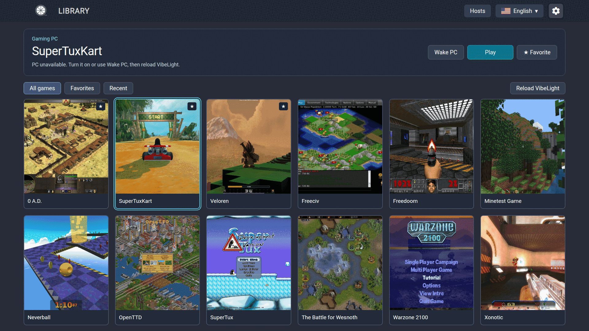

  <picture>
    <source media="(prefers-color-scheme: dark)" srcset="docs/images/vibelight-readme-logo.png">
    <source media="(prefers-color-scheme: light)" srcset="docs/images/vibelight-readme-logo-light.png">
    
  </picture>

**VibeLight-Tizen** is an independently maintained, vibe-coded **fork of [Moonlight Tizen](https://github.com/brightcraft/moonlight-tizen)** for Samsung Smart TVs.

Stream PC games through [VibeShine](https://github.com/Nonary/VibeShine) (recommended), [Sunshine](https://app.lizardbyte.dev/Sunshine/) or NVIDIA GameStream. The goal: keep improving VibeLight on Tizen OS toward a **console-like experience**, with **smoother gameplay and low latency**, without sacrificing image quality.

---

## Start here

Samsung TV with **Tizen 5.5+**, a compatible gamepad, and a PC running
[VibeShine](https://github.com/Nonary/VibeShine) or
[Sunshine](https://app.lizardbyte.dev/Sunshine/).

1. [Download a WGT](https://github.com/samirmartins/vibelight-tizen/releases/latest).
   **Normal** does not request panel Game Mode; **ForceGM** does.
2. [Install and pair the PC](INSTALLATION.md). Preserve the signing profile when
   updating; uninstalling can remove pairing and preferences.
3. Select a game and Play. Resume reconnects to a running app; Guide/Home opens
   the in-game menu. Disconnect keeps the game on the PC; End game on PC closes it.

**User documentation:** [visual guide, settings, diagnostics and troubleshooting](docs/index.html).
The static guide is prepared for GitHub Pages in `docs/`; it is not published yet.
It documents the current source. New settings/history screens are not in the
previously published 4.0.2 packages; check the notes of the version you install.

## Interface

Simulated preview · [Image credits and licenses](docs/images/ATTRIBUTION.md).

## Current source

- Six settings categories: Picture, Sound, Controls, PCs and library, Diagnosis,
  General and about. English, Brazilian Portuguese and Spanish menus.
- Refresh library updates the game list; Restart app is a separate maintenance action.
- Statistics start only after explicit in-game activation. Hiding the overlay
  keeps recording until that session ends. Every new session starts inactive.
- Only the **last 10 session summaries**, stored **on the TV**, with A/B comparison
  and technical details. **No statistics are uploaded.** Partial coverage is identified.
- Defaults: H.264, 1080p, 60 FPS, 30 Mbps; frame pacing ON, rumble ON, mouse mode OFF.
  The adaptive audio buffer has a default 100 ms ceiling, not fixed 100 ms latency.
- Ultra-low video latency is separate from ForceGM and may be unstable on some
  TVs/system versions. It remains OFF by default, including with ForceGM.

## Development and feedback

[Validation and local build notes](build-tools/README.md) ·
[Samsung build instructions](README.Samsung.md) ·
[Report an issue](https://github.com/samirmartins/vibelight-tizen/issues).
Keep private network details and signing credentials out of screenshots and logs.

## Credits

- **[BrightCraft](https://github.com/brightcraft/moonlight-tizen)** — fork foundation.
- **[ruanformigoni](https://github.com/ruanformigoni/moonlight-tizen)** — initial Web Audio foundation.
- **[Moonlight Game Streaming Project](https://github.com/moonlight-stream)** — core streaming libraries.
- **Earlier upstream work:** [Samsung Developers Forum](https://github.com/SamsungDForum/moonlight-chrome), [KyroFrCode](https://github.com/KyroFrCode/moonlight-chrome-tizen), [OneLiberty](https://github.com/OneLiberty/moonlight-chrome-tizen) and [ToyPoodleGaming](https://github.com/toypoodlegaming/moonlight-chrome-tizen).
- **Claude Code and OpenAI Codex** — development assistance.

And to **every contributor** to those projects.
