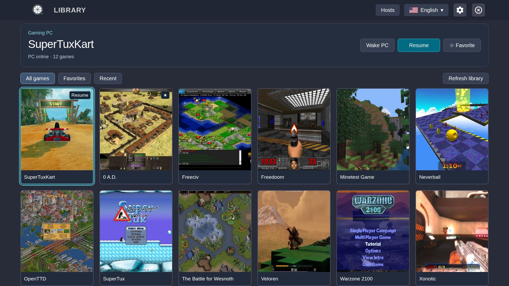

  <picture>
    <source media="(prefers-color-scheme: dark)" srcset="docs/images/vibelight-readme-logo.png">
    <source media="(prefers-color-scheme: light)" srcset="docs/images/vibelight-readme-logo-light.png">
    
  </picture>

**VibeLight-Tizen** is an independently maintained, vibe-coded **fork of [Moonlight Tizen](https://github.com/brightcraft/moonlight-tizen)** for Samsung Smart TVs.

Stream PC games through [VibeShine](https://github.com/Nonary/VibeShine) (recommended), [Sunshine](https://app.lizardbyte.dev/Sunshine/) or NVIDIA GameStream. The goal: keep improving VibeLight on Tizen OS toward a **console-like experience**, with **smoother gameplay and low latency**, without sacrificing image quality.

---

## Start here

Samsung TV with **Tizen 5.5+**, a compatible gamepad, and a PC running
[VibeShine](https://github.com/Nonary/VibeShine) or
[Sunshine](https://app.lizardbyte.dev/Sunshine/).

1. [Download a WGT](https://github.com/samirmartins/vibelight-tizen/releases/latest).
   **Normal** does not request panel Game Mode; **ForceGM** does.
2. [Install and pair the PC](INSTALLATION.md). Preserve the signing profile when
   updating; uninstalling can remove pairing and preferences.
3. Select a game and Play. Resume reconnects to a running app; Guide/Home opens
   the in-game menu. Disconnect keeps the game on the PC; End game on PC closes it.

## Documentation

**Visual guide:** [English](docs/index.html) ·
[Português (Brasil)](docs/pt-br/index.html) · [Español](docs/es/index.html).
English is the first-visit default. The visible language selector remembers an
explicit choice and keeps the current topic. Search opens individual answers
with excerpts; setup, pairing and the game menu have illustrated steps.

The guide is ready for **GitHub Pages but is not hosted yet**. These links show
HTML source on GitHub; open `docs/index.html` from a local checkout for the
working site. For installation instructions readable directly on GitHub, use
the [Installation Guide](INSTALLATION.md).

| Status | Where to read |
| --- | --- |
| Published packages: **v4.0.2** | [Downloads and release notes](https://github.com/samirmartins/vibelight-tizen/releases/tag/v4.0.2) |
| Current source, **unreleased** | [Changelog](CHANGELOG.md#unreleased) · [Draft release notes](RELEASE_NOTES.md) · visual guide above |

The new settings, per-game statistics activation and ten-session history belong
to the unreleased source. They are not available in the published 4.0.2 packages.

## Interface

Unreleased interface preview · artificial data ·
[Image credits and licenses](docs/images/ATTRIBUTION.md).

## Current source

- Six settings categories: Picture, Sound, Controls, PCs and library, Diagnosis,
  General and about. English, Brazilian Portuguese and Spanish menus.
- Refresh library updates the game list; Restart app is a separate maintenance action.
- Statistics start only after explicit in-game activation. Hiding the overlay
  keeps recording until that session ends. Every new session starts inactive.
- Only the **last 10 session summaries**, stored **on the TV**, with A/B comparison
  and technical details. **No statistics are uploaded.** Partial coverage is identified.
- Defaults: H.264, 1080p, 60 FPS, 30 Mbps; frame pacing ON, rumble ON, mouse mode OFF.
  The adaptive audio buffer has a default 100 ms ceiling, not fixed 100 ms latency.
- Ultra-low video latency is separate from ForceGM and may be unstable on some
  TVs/system versions. It remains OFF by default, including with ForceGM.

## Development and feedback

[Validation and local build notes](build-tools/README.md) ·
[Samsung build instructions](README.Samsung.md) ·
[Contributing](.github/CONTRIBUTING.md) ·
[Report an issue](https://github.com/samirmartins/vibelight-tizen/issues).
For a playback issue, optionally enable Statistics in that game, leave the
session, then read Settings → Diagnosis → Last diagnosis or History. Recording
is local; sharing a redacted screenshot in an issue is a separate, manual choice.
Keep private network details and signing credentials out of screenshots and logs.
Include the version, variant and build from General & about → System information.
To remove one local diagnosis, open its record and choose Delete diagnosis.

## Credits

- **[BrightCraft](https://github.com/brightcraft/moonlight-tizen)** — fork foundation.
- **[ruanformigoni](https://github.com/ruanformigoni/moonlight-tizen)** — initial Web Audio foundation.
- **[Moonlight Game Streaming Project](https://github.com/moonlight-stream)** — core streaming libraries.
- **Earlier upstream work:** [Samsung Developers Forum](https://github.com/SamsungDForum/moonlight-chrome), [KyroFrCode](https://github.com/KyroFrCode/moonlight-chrome-tizen), [OneLiberty](https://github.com/OneLiberty/moonlight-chrome-tizen) and [ToyPoodleGaming](https://github.com/toypoodlegaming/moonlight-chrome-tizen).
- **Claude Code and OpenAI Codex** — development assistance.

And to **every contributor** to those projects.
